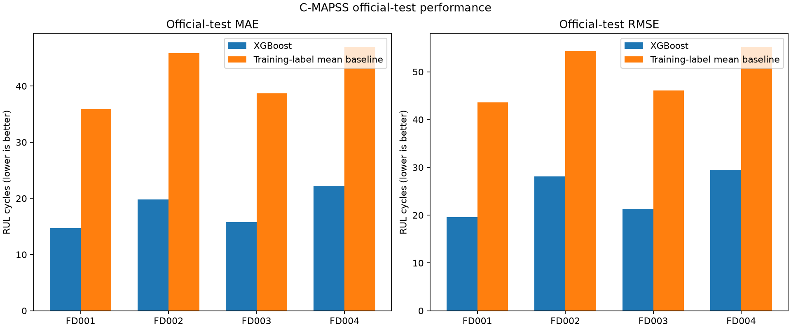
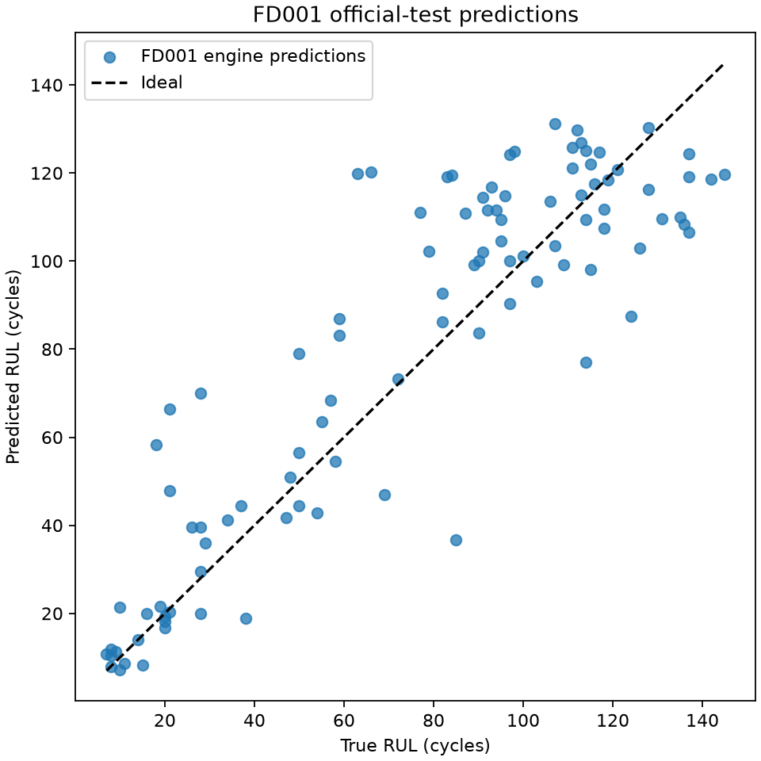
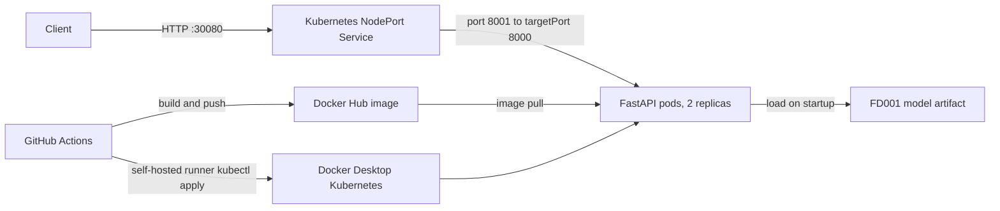

# NASA Engine RUL MLOps Project

This project predicts remaining useful life (RUL) for NASA turbofan engines. It includes data validation, feature engineering, XGBoost training, MLflow tracking, DVC reproducibility, a FastAPI inference service, Docker packaging, and Kubernetes deployment manifests.

## Model performance

Metrics below are from a fresh run of `python -m src.pipelines.performance_report` using the
saved model artifacts. Evaluation uses the official NASA C-MAPSS test subset: one prediction
for each engine at its final observed cycle, compared with the supplied RUL label. The
baseline predicts the mean capped RUL from the corresponding training subset for every test
engine. Run `python -m src.pipelines.train_pipeline --dataset ALL` followed by the report
command to retrain and reproduce these results.

| Dataset | Test engines | XGBoost MAE | Mean baseline MAE | XGBoost RMSE | Mean baseline RMSE |
| --- | ---: | ---: | ---: | ---: | ---: |
| FD001 | 100 | 14.67 | 35.93 | 19.61 | 43.60 |
| FD002 | 259 | 19.83 | 45.87 | 28.06 | 54.32 |
| FD003 | 100 | 15.77 | 38.73 | 21.33 | 46.08 |
| FD004 | 248 | 22.19 | 46.99 | 29.49 | 55.23 |

Errors are measured in RUL cycles; lower is better. The model outperforms the constant
training-mean baseline on both metrics across all four subsets. Evaluation output with
unrounded metrics and R²/NASA score is in
[`docs/performance_metrics.json`](docs/performance_metrics.json).





## Model evaluation

The FD001 pipeline reports two complementary evaluations:

- **Engine holdout:** a model trained on 80% of the training engines and
  evaluated on the remaining 20%, with no engine appearing in both partitions.
- **Official NASA test:** the deployable model is retrained on all training
  engines, then evaluated at the final observed cycle of each truncated test
  trajectory against NASA's supplied RUL labels.

Latest reproduced results:

| Dataset | Holdout R2 | Official MAE | Official RMSE | Official R2 | NASA score |
| --- | ---: | ---: | ---: | ---: | ---: |
| FD001 | 0.838 | 14.67 | 19.61 | 0.777 | 1170.63 |
| FD002 | 0.781 | 19.83 | 28.06 | 0.728 | 8956.70 |
| FD003 | 0.845 | 15.77 | 21.33 | 0.735 | 2379.53 |
| FD004 | 0.766 | 22.19 | 29.49 | 0.707 | 7887.04 |

The asymmetric NASA score penalizes predictions that overestimate remaining
life more heavily; lower is better. Exact, unrounded values are written to
`artifacts/<dataset>_metrics.json` and logged to MLflow. Each dataset also
produces its own deployable `artifacts/<dataset>_model.joblib` model.

## Quick start

Create and activate `.venv`, install the project dependencies, and reproduce the DVC
pipeline. Use the activation command for your shell:

```powershell
python -m venv .venv
.\.venv\Scripts\Activate.ps1
python -m pip install -r requirements.txt
python -m dvc repro
uvicorn src.api.app:app --host 0.0.0.0 --port 8000
```

```bash
python -m venv .venv
source .venv/bin/activate
python -m pip install -r requirements.txt
python -m dvc repro
uvicorn src.api.app:app --host 0.0.0.0 --port 8000
```

The API is available at `http://localhost:8000`. Open `http://localhost:8000/docs` for interactive API documentation.

## Project structure

- `src/data` — dataset loaders and validation utilities
- `src/features` — feature engineering for sensor and degradation signals
- `src/models` — training and evaluation logic
- `src/api` — FastAPI prediction service
- `configs/` — training and inference configuration
- `artifacts/` — generated model and metrics outputs
- `.github/workflows/ci.yml` — CI validation workflow
- `dvc.yaml` — DVC stage definition for reproducible training
- `docker-compose.yml` — local stack for API and MLflow

## Local setup

1. Complete the environment setup from Quick start.

2. Train a single dataset:
   ```bash
   python -m src.pipelines.train_pipeline --dataset FD001 --config configs/train_config.yaml
   ```

   Train and evaluate all four C-MAPSS subsets:
   ```bash
   python -m src.pipelines.train_pipeline --dataset all --config configs/train_config.yaml
   ```

3. Run the API locally:
   ```bash
   uvicorn src.api.app:app --host 0.0.0.0 --port 8000 --reload
   ```

4. Open the health endpoint:
   ```bash
   curl http://localhost:8000/health
   ```

## MLflow

MLflow tracking is configured in `src/pipelines/train_pipeline.py` with a local file-backed store by default.

```bash
export MLFLOW_TRACKING_URI=file://$PWD/mlruns
python -m src.pipelines.train_pipeline --dataset FD001 --config configs/train_config.yaml
mlflow ui --backend-store-uri file://$PWD/mlruns --host 0.0.0.0 --port 5000
```

## DVC

The DVC pipeline in `dvc.yaml` covers ingestion, training/evaluation for FD001-FD004, plot generation, and serving metadata:

```bash
python -m pip install -r requirements.txt
python -m dvc repro
```

The pipeline stages are:

- `ingest_data` — validates and materializes the raw FD001 training dataset into `data/processed/`
- `train_model` — trains all four XGBoost models and writes model and metrics artifacts
- `evaluate_models` — evaluates the saved models on official NASA test labels, compares to a mean-RUL baseline, and generates the plots above
- `serve_model` — validates the model artifact and writes a serving manifest/config used by the FastAPI API

## Docker

Build and run the inference API and MLflow server locally:

```bash
docker compose up --build
```

The API is exposed on `http://localhost:8000` and MLflow on `http://localhost:5000`.

## CI/CD

GitHub Actions installs dependencies, runs unit tests, and reproduces the DVC pipeline. The latest available successful CI run is [run #32](https://github.com/clumumba/nasa_rul_engines/actions/runs/33829570905) on commit `3cb9c4e`. It predates the current uncommitted changes; CI must run again after they are pushed.

- `.github/workflows/ci.yml` — tests and `dvc repro`
- `.github/workflows/docker-build.yml` — DVC reproduction and Docker build/publish
- `.github/workflows/deploy_svc.yml` — Kubernetes manifest validation
- `.github/workflows/kubectl-deploy.yml` — Kubernetes deployment
- `deploy.yml` and `deploy_svc.yml` — API deployment and service manifests

## Deployment architecture



## Kubernetes deployment

The root-level manifests deploy the Docker Hub image `clumumba62/nasa_rul:<tag>`:

- `deploy.yml` — two API replicas with CPU and memory requests/limits
- `deploy_svc.yml` — `NodePort` service on port `30080`

Confirm that `kubectl` is installed and connected to the target cluster:

```bash
kubectl config current-context
kubectl cluster-info
```

Apply the deployment and service:

```bash
kubectl apply -f deploy.yml
kubectl apply -f deploy_svc.yml
```

Verify the rollout and resources:

```bash
kubectl rollout status deployment/nasa-rul-deployment
kubectl get deployments,pods,services -l app=nasa_rul
kubectl describe service nasa-rul-service
```

The service uses `NodePort` `30080`. For Minikube, get the service URL with:

```bash
minikube service nasa-rul-service --url
```

For another cluster, call the health endpoint at `<node-ip>:30080`:

```bash
curl http://<node-ip>:30080/health
```

On Docker Desktop, the NodePort is commonly reachable at `http://localhost:30080`.
Alternatively, forward the service port to local port 8001:

```bash
kubectl port-forward service/nasa-rul-service 8001:8001
curl http://localhost:8001/health
```

### Brief local deployment demonstration

From the repository root, with Docker Desktop Kubernetes enabled and the `docker-desktop`
context active:

```powershell
python -m dvc repro
$tag = Get-Date -Format "yyyyMMddHHmmss"
docker build -t "clumumba62/nasa_rul:$tag" .
docker login
docker push "clumumba62/nasa_rul:$tag"
kubectl apply -f deploy.yml
kubectl apply -f deploy_svc.yml
kubectl set image deployment/nasa-rul-deployment "nasa=clumumba62/nasa_rul:$tag"
kubectl rollout status deployment/nasa-rul-deployment
kubectl port-forward service/nasa-rul-service 8001:8001
```

In a second terminal, verify the API with `curl http://localhost:8001/health` and make a
history prediction using the example below. This is a command walkthrough, not a completed
deployment: the Docker daemon and Kubernetes API were unavailable during this documentation
update, so no successful local cluster rollout is claimed.

Remove the resources when finished:

```bash
kubectl delete -f deploy_svc.yml
kubectl delete -f deploy.yml
```

### Kubernetes deployment through GitHub Actions

The Docker workflow publishes a commit-tagged image to Docker Hub on every push to `main`. After that workflow succeeds, the deployment workflow runs on the self-hosted Docker Desktop runner, replaces the image in the checked-out `deploy.yml` with `clumumba62/nasa_rul:<commit-sha>`, and applies the deployment and service. Add a repository secret named `KUBE_CONFIG` only if using a remote runner/cluster; the Docker Desktop self-hosted runner uses its local `docker-desktop` context.

You can also start the deployment manually through `workflow_dispatch`:

```bash
kubectl config use-context docker-desktop
kubectl apply -f deploy.yml
kubectl apply -f deploy_svc.yml
```

The Docker workflow requires the `DOCKER_USERNAME` and `DOCKER_LOGIN` repository secrets. It publishes both `clumumba62/nasa_rul:<commit-sha>` and `clumumba62/nasa_rul:v1`; the deployment uses the immutable commit tag.

## Prediction API

`POST /predict/history` accepts an engine's raw historical cycle readings. Each
reading includes `cycle`, `setting_1` through `setting_3`, and `sensor_1` through
`sensor_21`. The API sorts cycles, validates they are unique and consecutive,
and applies the same lag, delta, rolling-window, and training lag-fill values
used by the saved model. It predicts RUL for the latest cycle in the request.
Send recent consecutive cycles; five readings provide a complete rolling window.

Example using five real FD001 test cycles from the checked-in NASA data:

```python
import requests
from src.data.load import load_test

history = (
    load_test("FD001")
    .query("unit == 1")
    .head(5)
    .drop(columns="unit")
    .to_dict(orient="records")
)
response = requests.post(
    "http://localhost:8001/predict/history",
    json={"history": history},
)
response.raise_for_status()
print(response.json())
```

Sample response from a local request using the saved FD001 model:

```json
{
  "predicted_rul": 123.22319793701172,
  "cycle": 5,
  "history_cycles": 5
}
```

`GET /metadata` still describes the model's engineered input schema. The
existing `POST /predict` route remains available for callers that already
produce a complete, exact feature vector; ordinary consumers can use
`POST /predict/history` instead.
