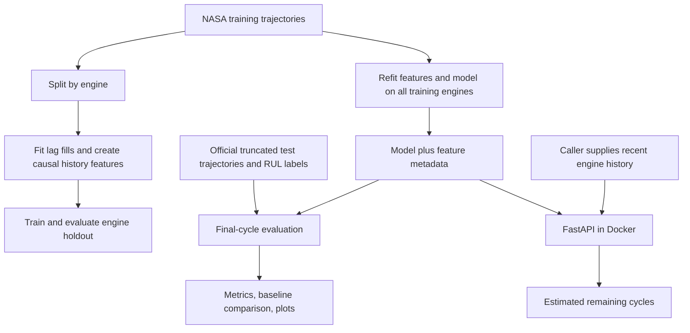

# Project review and interview guide

Review date: 22 October 2026. Scope: local source, configuration, tests, data counts, and saved metrics. Saved model performance is reported evidence, not a fresh training reproduction in this review. Existing uncommitted changes were present before the review.

Verification: ran the existing test suite using `../.nasa/Scripts/python.exe -m pytest -q` from the repository root: **15 passed**, with one Starlette/HTTPX deprecation warning. Independently counted test engine IDs and RUL labels for all four subsets; counts match the saved report. No fresh training, Docker build, or cluster rollout was performed. This review adds documentation only.

## Overall assessment

This is a credible end-to-end machine learning portfolio project. Its strongest evidence is engine-level validation, official test evaluation, shared training/inference feature engineering, and a usable inference API. The biggest improvement is to make those engineering decisions easy to find and ensure the automation accurately represents the data flow.

Position it as **a reproducible predictive-maintenance ML prototype with containerized inference and Kubernetes deployment automation**. The code does not establish a live production service, real aircraft performance, cost savings, or a monitored maintenance decision system. The API's current “Production-ready” description overstates the evidence.

## What the project actually does

1. Loads NASA C-MAPSS text files containing engine IDs, cycle numbers, three operating settings, and 21 sensor measurements. Training trajectories run to failure; test trajectories stop before failure.
2. Creates a training target for every cycle: `min(last cycle for engine − current cycle, 130)`. The cap is configurable. This is a modeling assumption that treats early healthy life as a plateau.
3. Splits training engines 80/20. All cycles of an engine stay in one partition, preventing the same engine from appearing in both training and validation.
4. Builds sensor history features separately within each engine: previous value, change since previous cycle, rolling mean, and rolling standard deviation. Default window: five cycles. Initial lag values use training sensor medians.
5. Trains an XGBoost regressor and measures the engine holdout. Then fits a separate deployable model on all training engines.
6. Evaluates the deployable model using one final-cycle prediction per official test engine against its supplied RUL label. The official labels are not capped in the current evaluation.
7. Compares predictions with a constant baseline: the mean of capped training-cycle RUL labels. Writes MAE, MSE, RMSE, R², and asymmetric NASA score; logs experiments to MLflow.
8. Repeats training for FD001–FD004, saving a separate model for each. Produces comparison plots and a JSON performance report.
9. Serves one selected model through FastAPI, defaulting to FD001. Loads it once at application startup. `/predict/history` accepts raw consecutive cycle readings and builds features; `/predict` accepts an exact engineered feature vector. `/metadata` exposes feature names, and `/health` checks that startup loaded the model.
10. Provides Docker packaging, a development Compose stack, CI tests/DVC reproduction, image publishing, and Kubernetes deployment configuration with two replicas and health probes.

The service is stateless: callers supply history for each request. It does not store engine telemetry, choose among four models per request, schedule maintenance, monitor drift, or retrain automatically in response to production data.

## Tools and why they are present

These are defensible rationales based on implementation; they do not establish the original author's decision process.

| Tool | Actual responsibility | How to explain the choice and tradeoff |
| --- | --- | --- |
| Python | Pipeline, model, service, tests | One language keeps feature logic reusable across training and inference. |
| pandas | Load tabular telemetry, group by engine, lag and roll sensors | Makes per-engine time-history transformations explicit; repeated grouping could become expensive at larger scale. |
| NumPy | Numeric metric operations | Supports vectorized calculations, including asymmetric NASA penalties. |
| scikit-learn | Engine-ID splitting and standard regression metrics | Uses established evaluation utilities; this project does not currently wrap preprocessing in a sklearn Pipeline. |
| XGBoost | Nonlinear regression over engineered sensor features | A reasonable tabular model with modest implementation complexity. It captures history through features rather than learning sequences directly. No experiment currently proves it is better than an LSTM or other model family. |
| MLflow | Log runs, selected parameters, metrics, and model | Answers “what happened in each experiment?” No registry promotion or production monitoring is implemented. |
| DVC | Dependency graph, cached stage outputs, lock file | Answers “what needs rebuilding when inputs change?” Complements MLflow, but needs the graph/config cleanup below. No remote is configured in the inspected `.dvc/config`. |
| joblib | Serialize the serving model and custom preprocessing attributes | Convenient Python artifact; tied to library compatibility. A native XGBoost model plus an explicit metadata file would make the artifact contract clearer. |
| YAML / PyYAML | Training, inference, and pipeline configuration | Makes settings readable; duplicated sources currently undermine that benefit. |
| FastAPI | HTTP prediction routes and generated API documentation | Makes the trained model usable by another application. |
| Pydantic | Validate request fields, finite numbers, and cycle sequences | Rejects malformed requests before feature engineering or inference. |
| Uvicorn | Run the ASGI application | Hosts FastAPI; it does not perform model training. |
| Matplotlib | Static model comparison and prediction plots | Makes saved evaluation results reviewable in GitHub without running the pipeline. |
| pytest / HTTPX | Unit tests and API test client | Verify metric and input-contract behavior. Existing tests include mocked API models; add a small real-artifact integration check. |
| Docker | Package serving dependencies, source, and model | Provides a portable inference runtime; build-time deserialization catches some artifact incompatibilities. |
| Docker Compose | Local API and MLflow processes | Convenient development setup; the reload command and bind mount make it a development configuration. |
| GitHub Actions | Test, reproduce, build/publish, validate/deploy | Automates repeatable steps. Current workflows need a shared release gate. |
| Docker Hub | Store published container images | Carries the API and model to the cluster; commit tags improve traceability. |
| Kubernetes | Replicas, resource limits, health probes, service routing | Demonstrates deployment mechanics. Optional for this small project; justify it as an operational learning objective, not a scale requirement proven by traffic. |

## Prioritized cleanup findings

### Priority 1: Make the results and release trustworthy

**1. Make configuration have one source of truth.**

Evidence: `params.yaml` duplicates `configs/train_config.yaml` and inference settings. DVC watches params, while training reads the separate config file. Dataset selection is controlled by the CLI, not the config's `dataset` field. XGBoost settings and its seed are hardcoded in `src/models/baseline_xgb.py`; changing the config seed changes the split but not the model seed.

Action: choose one canonical configuration; pass its model settings to training; log the complete effective configuration, versions, and code/data identifiers. Acceptance: changing a documented parameter changes the intended behavior and the recorded run metadata.

**2. Correct the DVC graph and output declarations.**

Evidence: `ingest_data` writes a processed FD001 CSV, but training reads raw files directly. `serve_model` only checks that a model file exists and writes a manifest; the API never reads that manifest. Training metric JSON and copied documentation plots/metrics are not declared as stage outputs. Broad `src` dependencies cause unrelated changes to invalidate training.

Action: either consume validated processed data for all four datasets or remove the unused materialization step. Rename the final stage to describe packaging/validation, or make its manifest a real serving input. Declare generated outputs/metrics and narrow dependencies. Acceptance: a clean reproduction restores all advertised reports and uses a truthful dependency chain.

**3. Align training and serving environments.**

Evidence: `requirements.txt` uses lower bounds; serving dependencies are pinned separately. `PRODUCTION_CHANGES.md` already records an XGBoost serialization version warning.

Action: lock compatible training and serving versions and record artifact provenance. If switching to native XGBoost serialization, also persist feature order, window, lag-fill values, dataset, cap, and versions in a metadata sidecar. Acceptance: train, load in the serving image, and predict successfully with the same release artifact.

**4. Gate publishing and deployment on validation of the same revision.**

Evidence: CI and Docker build are separate workflows; publishing does not depend on successful unit tests. Deployment follows Docker build success. Deployment chooses the triggering image SHA, but checkout does not explicitly select that same SHA.

Action: share a test/train/build release chain, reuse artifacts, and check out the exact deployed revision. Add a container prediction smoke test and record the deployed digest. Acceptance: a failing test prevents a release, and source/config/model/image provenance agree.

**5. Add `.dockerignore` and narrow image contents.**

Evidence: the Dockerfile uses `COPY . .`, and no `.dockerignore` exists. Local caches, tracking data, repository metadata, and other unnecessary files can enter the build context/image. The image also installs build tools and git and runs as root.

Action: explicitly include serving source/config/model, exclude development/generated stores, check whether build tools are required, and use a non-root runtime. Acceptance: inspect the image contents and verify health plus prediction.

### Priority 2: Make the service contract and ML argument stronger

**6. Clarify model selection and short-history behavior.**

Expose dataset, model version, units (`cycles`), feature window, and required history in `/metadata`. The API accepts one reading even for a late-life engine; this produces partial-window statistics and a median-filled lag, unlike a complete recent history. Document that distinction or require a complete window after startup. Bound request history length and validate preprocessing metadata at startup; currently health can succeed while `/predict/history` returns 503 for missing metadata.

**7. Strengthen data and feature tests.**

`validate_dataframe` checks presence, emptiness, and nulls but not finite numeric values, valid integer IDs/cycles, duplicate engine-cycle pairs, or continuity. Add focused tests for engine-disjoint splitting, exact capped labels, no cross-engine rolling state, future rows not changing earlier features, and full-history versus recent-window inference parity. Existing test coverage is useful but the training pipeline test mainly verifies dispatch across datasets.

**8. Connect MLflow deliberately.**

The training default is `mlruns/`; Compose starts a separate SQLite-backed MLflow server. The API's `MLFLOW_TRACKING_URI` does not connect host training to that server, and the API does not use MLflow. Document a working tracking/artifact arrangement, align versions, and test a training run appearing in the chosen UI.

**9. Improve model explanations and evaluation depth.**

Add raw-sensor versus engineered-history ablation, a simple learned baseline, and grouped cross-validation for development. Keep the official test set for final reporting. Add errors by true-RUL range and operating condition, especially dangerous overestimates near failure. Add engine-bootstrap uncertainty for aggregate metrics. Explain cap/window choices with validation evidence rather than presenting defaults as optimal.

For prediction explanations, add a global feature-importance plot and a local attribution example, grouping related raw/lag/rolling sensor features where useful. Explain that correlated features share attribution and importance does not prove a physical cause. SHAP is a possible addition, not a current capability.

**10. Remove small sources of confusion.**

Rename `baseline_xgb.py` to distinguish the principal model from the constant baseline. Remove the unused `target_col` argument in `split_by_unit` and unused holdout model binding if unnecessary. Keep `src/load.py` only if a compatibility import is needed. Move long inline DVC Python commands into modules. Standardize formatting/line endings and add a lightweight formatter/linter. Consolidate repeated setup instructions and evaluation code where that reduces drift.

### Priority 3: Make the repository easy to assess

- Put the problem, one result, pipeline diagram, and a runnable prediction demo at the top of the README. Move detailed deployment instructions into `docs/deployment.md`.
- Use port 8000 in the default demo; the current prediction example uses 8001, which depends on the Kubernetes port-forward path.
- Include a short model card: intended use, simulated data, subset selection, cap, evaluation protocol, limitations, and failure cases.
- Add dataset provenance/citation inside the repository. The parent-folder dataset readme is not in the Git repository and contains inconsistent FD004 counts. Local files contain 248 FD004 test engines and 248 labels; preserve original source material and explain the verified counts separately.
- Track intended documentation/plots before sharing: `docs/` was untracked at review start. `PRODUCTION_CHANGES.md` is ignored, so move lasting guidance into tracked documentation.
- Show a passing CI link for the actual shared revision. The current README correctly says its linked run predates local changes; replace that historical pointer once current checks run.
- Add an appropriate code license if intended, separately from dataset usage/citation information.
- A short recorded API walkthrough is enough for a first recruiter demo. A dashboard is optional; adding tools will not fix unclear claims.

## Results you can explain honestly

From the saved `docs/performance_metrics.json`:

| Dataset | Test engines | Model MAE, cycles | Constant baseline MAE | Relative MAE reduction |
| --- | ---: | ---: | ---: | ---: |
| FD001 | 100 | 14.67 | 35.93 | 59.17% |
| FD002 | 259 | 19.83 | 45.87 | 56.77% |
| FD003 | 100 | 15.77 | 38.73 | 59.29% |
| FD004 | 248 | 22.19 | 46.99 | 52.79% |

Reduction is `(baseline MAE − model MAE) / baseline MAE`. These are improvements over a constant baseline, not over prior research. MAE of 14.67 means average absolute error of about 15 operating cycles on that evaluation; it is not “85% accuracy.” Holdout metrics aggregate cycles from held-out engines against capped labels, whereas official metrics use one endpoint per engine against uncapped labels. They answer different questions and should not be treated as directly interchangeable.

## Recruiter introduction

> I built a machine learning prototype that estimates the remaining operating cycles of simulated turbofan engines from sensor histories. It trains and evaluates models on four NASA C-MAPSS subsets, then exposes a selected model through a validated API. The saved official-test results show a 53–59% reduction in mean absolute error against a constant training-mean baseline. My main engineering focus was preventing engine-level leakage, keeping training and inference features consistent, and making the model reproducible and deployable.

Possible résumé bullets, if these accurately represent your own contribution:

- Built a NASA C-MAPSS RUL pipeline using XGBoost and causal sensor-history features; achieved 14.67-cycle MAE on FD001 and 53–59% lower MAE than a constant baseline across four official test subsets.
- Implemented engine-disjoint validation, shared training/inference preprocessing, MLflow experiment tracking, and DVC pipeline orchestration.
- Packaged a validated FastAPI inference service in Docker and implemented Kubernetes manifests and GitHub Actions deployment automation.

Use “deployed” only when you can show a successful deployment. Do not claim measured downtime reduction or production-scale operation from this benchmark.

## Five-minute technical interview walkthrough

1. **Problem and data:** Define remaining useful life in cycles; explain run-to-failure training trajectories and truncated test trajectories. State that this is simulated benchmark data.
2. **Labels and leakage:** Write the capped RUL formula. Explain why random row splitting would let the same engine appear on both sides. Explain why preprocessing medians are fitted on training engines only.
3. **Model and features:** Show how three settings plus 21 raw sensors plus four derived features per sensor produce 108 features. Explain lag as recent state, delta as change, rolling mean as smoothed level, and standard deviation as local variability.
4. **Evaluation:** Show FD001 MAE against the constant baseline, then the other subsets. Explain endpoint-only official evaluation and why the NASA score penalizes optimistic RUL errors more heavily.
5. **Serving and tradeoffs:** Submit a five-cycle request, show the response and metadata, then show an invalid-history rejection. Explain stateless serving, artifact loading at startup, and the next improvements: configuration, artifact compatibility, release gates, and error analysis.

## Likely interview questions

| Question | Defensible answer |
| --- | --- |
| Why XGBoost rather than an LSTM? | It gives a manageable nonlinear tabular approach using explicit temporal features. I would need controlled experiments before claiming it beats a sequence model. |
| Why cap at 130? | It encodes an early-life plateau. It is a configurable assumption that should be selected with validation. It also makes long remaining lives harder to represent. |
| Why no scaling? | Tree models split on feature thresholds; standardized inputs are generally unnecessary for this model. Condition-aware features still deserve investigation. |
| How do you avoid leakage? | Split by engine before fitting preprocessing statistics; group causal lag/rolling features by engine; exclude ID, cycle, and target from model inputs. |
| Why both DVC and MLflow? | DVC manages pipeline dependencies and output reuse; MLflow records experiments. Their roles complement each other, and the present DVC graph needs cleanup. |
| Why does FD004 perform worse? | The supplied dataset description has more operating conditions and fault modes. That is a plausible contributor; error slicing is needed to establish what drives this model's errors. |
| What does Kubernetes add? | Replica management, probes, resource limits, and rollout practice. The portfolio does not demonstrate traffic requiring Kubernetes. |
| Is this explainable? | The feature construction and pipeline are explicit. Individual XGBoost predictions still need attribution and error analysis; feature names alone are not explanations. |
| Is it production ready? | It has useful serving safeguards and deployment configuration, but needs stronger release provenance, bounded inputs, observability, workload testing, and deployment-specific access controls. |
| What would you do next? | First fix configuration, DVC, and release consistency; then add ablations and failure analysis. Introduce more complex models only when experiments justify them. |

## Suggested order of work

First, make the README and demo coherent and commit the intended report assets. Next, fix configuration/DVC truthfulness and training-serving compatibility. Then gate releases and add a real-model smoke test. Finally, strengthen the modeling evidence with ablations, grouped validation, and explainability examples. This yields a clearer portfolio without expanding the stack unnecessarily.
